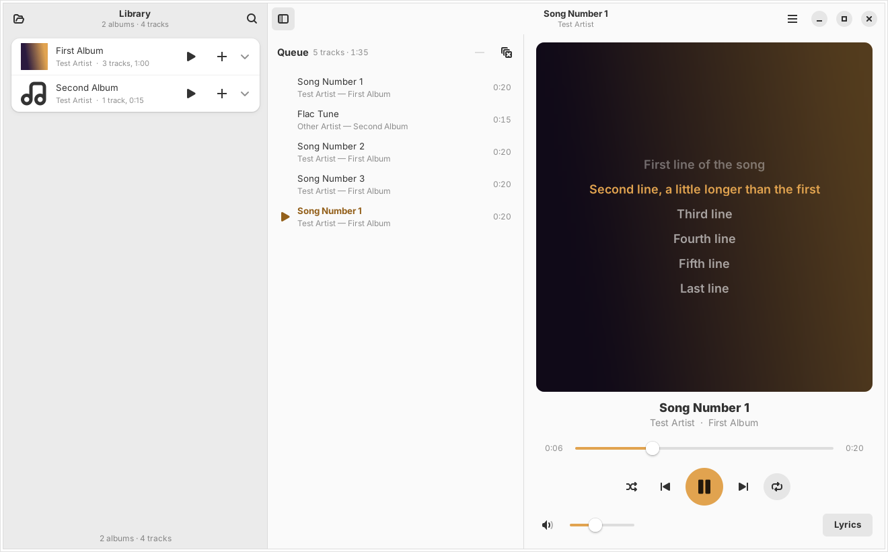

# Amber

A music player for local files, written in C++ with GTK 4, libadwaita,
GStreamer and TagLib. It follows the system's light or dark style, with a
yellowish-orange (`#e1a34f`) accent, and it can be controlled through MPRIS —
from `playerctl`, media keys, or the shell's media controls.



## Features

- **Formats:** MP3, FLAC and WebM.
- **Folders are albums:** Amber scans a music folder recursively, and every
  folder that directly contains audio files is one album. The album is named
  after the folder, and its tracks are ordered by file name, with numbers
  compared by value (`2 …` comes before `10 …`). Album tags are ignored, so
  two folders with the same album tag stay separate, and one folder with
  mixed tags stays together. A `Disc 2` sub-folder is an album of its own.
  Each album row shows the folder it lives in (for example the artist folder
  in an `Artist/Album` layout). Expand an album to see its tracks; the search
  bar filters by folder, track title or artist.
- **Queue:**
  - the ▶ and ＋ buttons on an album play it now or append it;
  - click a track to append it;
  - right-click an album or track for *Play Now*, *Play Next*, *Add to Queue*
    or *Replace Queue*;
  - drag albums or tracks onto the queue, at any position;
  - drop files or folders from a file manager onto the queue.

  Drag queue rows to reorder them, and press <kbd>Delete</kbd> to remove the
  selected ones.
- **Shuffle** and **repeat** (off → whole queue → current track). Shuffle
  plays every queued track once. Tracks you add while shuffling are mixed in
  among the tracks still to come; *Play Next* is always honoured; and
  *Previous* retraces the shuffled history.
- **Artwork:** the album folder's own image first (`cover.jpg`, `folder.png`,
  `front.jpg` and the like), then art embedded in the tracks (ID3 `APIC`,
  FLAC pictures, Matroska attachments with TagLib ≥ 2.2), then whatever the
  stream itself carries.
- **Lyrics, drawn over the blurred cover:** a matching `.lrc` file next to the
  track, embedded synchronised lyrics (ID3 `SYLT`), or embedded plain lyrics
  (`USLT`, `LYRICS`/`UNSYNCEDLYRICS`). Synced lyrics follow playback and
  highlight the current line; click a line to jump to it. Scroll to look ahead;
  the view catches up a few seconds later. <kbd>L</kbd> or the **Lyrics**
  toggle switches back to the plain cover.
- **MPRIS / playerctl:** Amber registers as `org.mpris.MediaPlayer2.amber`.
- **Session restore:** the queue, current track and position, volume, mute,
  shuffle, repeat and the window layout survive a restart.
- **Adaptive layout:** below ~960 px the library becomes an overlay sidebar
  (<kbd>F9</kbd> or the sidebar button).

## Building on Arch Linux

```sh
sudo pacman -S --needed base-devel meson gtkmm-4.0 libadwaita taglib \
    gstreamer gst-plugins-base gst-plugins-good
meson setup build
meson compile -C build
./build/amber-player
```

Install system-wide (desktop entry, icon, metainfo):

```sh
sudo meson install -C build          # installs into /usr/local
```

Or build a package with the included `PKGBUILD` (edit `_url` first if the
repository lives somewhere else):

```sh
cd packaging/arch && makepkg -si
```

Requirements: GTK ≥ 4.12, gtkmm ≥ 4.10, libadwaita ≥ 1.5, GStreamer ≥ 1.20
with the base and good plugins (MP3, FLAC and WebM decoding), TagLib ≥ 1.12
(2.x recommended) and a C++17 compiler.

## Usage

```sh
amber-player                       # opens the library from last time
amber-player ~/Music/Album  x.mp3  # queue files/folders and start playing
```

On first start Amber uses `~/Music` if it exists; otherwise choose a folder
with the folder button or <kbd>Ctrl</kbd>+<kbd>O</kbd>. <kbd>F5</kbd> rescans.
Unchanged files are read from a cache, so rescans are quick. Amber is a
single-instance application: running it again with paths plays them in the open
window.

| Key | Action |
| --- | --- |
| <kbd>Space</kbd> | Play / pause |
| <kbd>Ctrl</kbd>+<kbd>←</kbd> / <kbd>→</kbd> | Previous / next track |
| <kbd>Shift</kbd>+<kbd>←</kbd> / <kbd>→</kbd> | Seek 10 s |
| <kbd>Ctrl</kbd>+<kbd>↑</kbd> / <kbd>↓</kbd> | Volume up / down |
| <kbd>M</kbd> | Mute |
| <kbd>Ctrl</kbd>+<kbd>S</kbd> | Toggle shuffle |
| <kbd>Ctrl</kbd>+<kbd>R</kbd> | Cycle repeat mode |
| <kbd>L</kbd> | Show / hide lyrics |
| <kbd>Ctrl</kbd>+<kbd>F</kbd> | Search the library |
| <kbd>F9</kbd> | Show / hide the library |
| <kbd>F5</kbd> | Rescan the library |
| <kbd>Delete</kbd> | Remove the selected queue entries |
| <kbd>Ctrl</kbd>+<kbd>Q</kbd> | Quit |

Media keys work too, both directly in the window and through MPRIS.

## playerctl

```sh
playerctl -p amber play-pause
playerctl -p amber next
playerctl -p amber position 30          # seek to 0:30
playerctl -p amber position 10+         # 10 s forward
playerctl -p amber volume 0.5
playerctl -p amber shuffle On
playerctl -p amber loop Playlist        # None | Track | Playlist
playerctl -p amber open "file:///home/me/Music/Album/01.flac"
playerctl -p amber metadata --format '{{artist}} — {{title}}'
playerctl -p amber --follow status
```

Everything in the MPRIS `Player` interface is implemented: `PlaybackStatus`,
`Metadata` (title, artist, album, track and disc number, length, file URL and
`mpris:artUrl` — the folder's cover file, or embedded art written to
`~/.cache/amber-player/mpris/`), `Position`, writable `Volume`, `Shuffle` and
`LoopStatus`, the `Seeked` signal, and `Play`, `Pause`, `PlayPause`, `Stop`,
`Next`, `Previous`, `Seek`, `SetPosition` and `OpenUri`. The root interface
supports `Raise` and `Quit`.

## Files

The session lives in `~/.config/amber-player/session.ini`. The tag and
thumbnail caches live in `~/.cache/amber-player/`; deleting that folder is
always safe.

## Notes on WebM

TagLib reads WebM (Matroska) tags from version 2.2 on. With an older TagLib,
Amber falls back to the file name, then fills in the title, artist and artwork
from the stream itself once the track starts playing.

## Tests

```sh
meson test -C build
```

The tests cover the LRC/plain lyrics parser, folder-based album grouping and
ordering, and the queue logic, including shuffle, repeat, reordering, removal
of the playing track and the change signals the queue view mirrors.

For headless runs, `AMBER_AUDIO_SINK=fakesink` replaces the audio output.

## Source layout

| File | Purpose |
| --- | --- |
| `src/Application.*`, `src/main.cpp` | `GtkApplication`, single instance, command-line files |
| `src/MainWindow.*` | Window, split view, actions and shortcuts, session |
| `src/LibraryPanel.*` | Album/track rows, search, drag source, context menu |
| `src/QueuePanel.*` | Queue list view, reordering and drop target |
| `src/NowPlayingPanel.*` | Track info, seek bar, transport and volume |
| `src/CoverLyricsView.*` | Cover and lyrics over the blurred cover |
| `src/Player.*` | GStreamer `playbin` driver: loading, advancing, error skipping |
| `src/Mpris.*` | `org.mpris.MediaPlayer2` D-Bus service |
| `src/PlayQueue.*` | Queue model with shuffle order and repeat modes |
| `src/Library.*` | Background scan, one album per folder, tag and thumbnail caches |
| `src/MetadataReader.*` | TagLib access: tags, artwork, lyrics |
| `src/Lyrics.*` | LRC and plain-text lyrics parser |
| `src/Theme.*` | Amber accent for libadwaita, light and dark |
| `src/Session.*`, `src/DragData.*`, `src/ImageUtils.*`, `src/NaturalSort.*` | Helpers |
